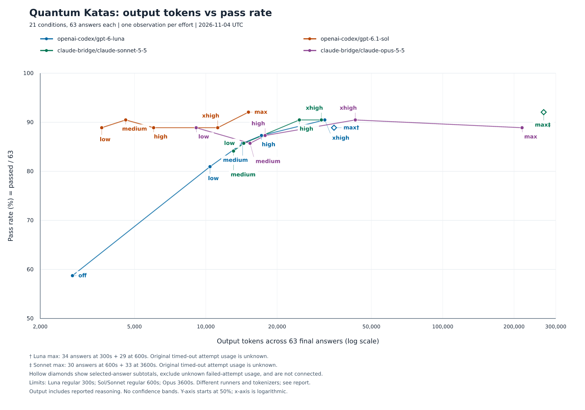

# Quantum Katas の4モデル・思考量別比較

実施日: 2026-11-04 (UTC)

固定63課題を、指定された4モデルの重複しない実効思考量で測定した。21条件について計1,323回答を得た。途中の時間切れ2件と、人間が個別に承認した再呼び出しを含むモデル呼び出し数は1,325件である。自動再試行、並列呼び出し、代替プロバイダーは使っていない。

## 図と全結果



- [SVG](../../research/plots/model-effort-matrix-2026-11-04.svg)
- [全21条件の採点・実行時間・利用量・料金の表](../../research/analyses/model-effort-matrix-2026-11-04/matrix-results.md)
- [図のデータと軸・上限・出典](../../research/plots/model-effort-matrix-2026-11-04.json)
- [原記録の一覧とハッシュ](../../research/analyses/model-effort-matrix-2026-11-04/matrix-manifest.json)

横軸は63最終回答の出力トークン数で、読み取りやすさのため対数目盛とした。縦軸は `passed / 63 * 100`。不合格、不許可、採点器エラーを分母から除外しない。縦軸の表示範囲は50〜100%である。通常の点は出力トークン数の実測値順で結び、各点に思考量を記した。各条件は1観測なので信頼区間は付けない。

### 観測された最多合格点

| モデル                          | 思考量 | 合格 / 63 | 合格率 | 出力トークン |
| ------------------------------- | ------ | --------: | -----: | -----------: |
| openai-codex/gpt-6-luna         | xhigh  |        57 | 90.48% |       31,788 |
| openai-codex/gpt-6.1-sol        | max    |        58 | 92.06% |       15,138 |
| claude-bridge/claude-sonnet-5-5 | max‡   |        58 | 92.06% |     266,852‡ |
| claude-bridge/claude-opus-5-5   | xhigh  |        57 | 90.48% |       42,755 |

思考量や出力トークン数を増やしても、合格率は単調には増えなかった。これは今回の観測の記述であり、モデルの総合順位や統計的な差を示すものではない。実行経路、文脈、トークン化、時間上限も異なる。

## 継続した2条件の扱い

- Luna/max† は300秒上限で得た34回答をそのまま使い、時間切れの35課題目と未着手28課題だけを600秒上限で呼んだ。63回答の結果は56 passed、2 failed、5 disallowed、0採点器エラー。出力小計は34,754トークン。
- Sonnet/max‡ は600秒上限で得た30回答をそのまま使い、時間切れの31課題目と未着手32課題だけを3,600秒上限で呼んだ。63回答の結果は58 passed、3 failed、2 disallowed、0採点器エラー。出力小計は266,852トークン。

元の回答はモデルへ送り直していない。中断時点で未採点だった回答だけを固定採点器で初回採点し、新しい回答と合わせた結果は、単一の正式な63課題研究試行ではなく、回答ごとの出典を持つ別の分析ファイルに保存した。

- [Luna/max の回答別出典](../../research/analyses/model-effort-matrix-2026-11-04/luna-max-continuation.json)
- [Sonnet/max の回答別出典](../../research/analyses/model-effort-matrix-2026-11-04/sonnet-max-continuation.json)

この2条件は、最初の時間切れ試行の利用量が不明なので、全試行の出力・費用は不明である。図には63最終回答の既知の出力小計を使い、通常の線から分けた中抜きの菱形で示した。失敗試行分を含む合計値とは主張しない。時間表は前景の `research solve` 呼び出しの経過時間である。元の時間切れ待ちは含むが、別途の原回答の初回採点、記録照合、指示待ちは含めていない。

原記録は変更せず、[中断記録の公開可能なコピー](../../research/partials/)と新しい29課題・33課題の正式な研究試行を別々に保存した。生の JSONL と非公開診断は `/tmp/qni-model-effort-matrix-evidence/` に保持した。認証情報、HTTP ヘッダー、実際の OAuth アカウントのメールアドレスは公開していない。

## 条件と比較上の制約

- 課題の git tree は `c8ed36f52b2ad3d27cc9477696d64d1d333f0594`、提出プロトコルは `blind-neutral-circuit-json-v1`。全課題の本文、プロンプト、採点器は測定中に変更していない。各回答のプロンプトのハッシュも照合した。
- Pi / pi-ai は1.5.0、Node.js は26.12.1。Bridge は0.9.3に[既存の隔離パッチ](pi-claude-bridge-0.9.3-setting-sources.patch)を適用したもの。ソースの SHA-256 は `e210ee6331949ca07b2b83db11810cc20addc2feb7a3a13ab388fc42c6dbfcc9`。SDK は0.3.293、SDK 同梱 Claude Code は2.1.293。
- 時間上限は300秒・600秒・3,600秒が混在する。通常の Luna 5条件は300秒、Sol と通常の Sonnet は600秒、Opus は3,600秒。継続した2条件の内訳は上記のとおり。全条件が同じ上限だったとは扱わない。
- `minimal` などの表示上の設定が同じ実効値になる場合は測定点を増やしていない。Luna の off は実効 none。Sol の off/minimal、Bridge 両モデルの off/minimal は low と重複するため対象外とした。要求の捕捉とソース確認は[安全修正の報告](model-effort-matrix-safety-2026-11-04.md)を参照。
- Codex と Bridge は同一の実行経路ではない。Bridge は Claude Code のプリセットへ課題のシステムプロンプトを追記し、OAuth アカウント情報も文脈に入る。この条件は事前に承認されている。トークン化も共通ではないため、横軸を共通の計算量や請求額への換算とはみなさない。
- 出力トークンは報告された思考分を含む。reasoning は内数であり、二重加算しない。Codex の Pi は提供元の reasoning 内訳の欠測も0へ変換するため、記録の0が実際の思考量0だったかは区別できない。欠測値をこちらで0に置き換えてはいない。
- Codex の記録料金は Pi の登録単価による推計で、請求額ではない。Bridge の記録料金0は登録単価が0だからであり、無料や費用の推計を意味しない。継続した2条件の回答分の小計と、未知の失敗試行分を含む全費用も分けた。

実行コードの主な固定点は、300秒が `cd885fbb7e5b01d2687896fec82aac52f3f9207d`、600秒が `3f1343a4d4463c2ebea5c473ec5ccdbe88750325`、3,600秒が `3b82e67b94599d97e1dde7f601b8af9fbb7ae55a`。各試行の実行条件、PATH、版、実行時間は `execution-envelope.json` と一覧から確認できる。

## 不許可と採点器の制限

計1,323回答の結果は1,150 passed、84 failed、84 disallowed、5 error だった。不許可84件のうち76件は逆三角関数を含む角度式の拒否、5件は JSON 形式違反、3件は制御・対象量子ビット数の違反だった。逆三角関数の文法やプロンプトを変更して回避することはしていない。

採点器エラー5件は通常の Luna の off/low に集中し、すべて空の操作列から作られた提出物で `circuit.json does not exist` となる既知の制限だった。error を failed に付け替えず、空回路の量子的な正否もこの測定では再解釈しない。2件の Pi 時間切れは別の呼び出しエラーとして記録し、表の全試行の実行エラー欄へ示した。

以前の Opus ベースラインの公式結果55/3/5/0と、修正後の診断56/3/4/0は不変のまま別枠に保った。旧 Pi 1.4.0 の点を今回の系列に重ねてはいない。

## モデルを呼ばずに再生成する

```bash
npm ci
bash scripts/setup_symbolic_python.sh
node scripts/plot_model_effort_matrix.js --check
node scripts/plot_model_effort_matrix.js
```

`--check` は保存済み23組の試行・中断記録と、1,325呼び出しの利用量索引、回答と採点結果のハッシュ、63課題の集合、各集計を照合する。描画は保存済み記録だけを使い、モデルも採点器も呼ばない。PNG は既存の Matplotlib 3.10.8 に同梱された DejaVu Sans と、ロックファイルで固定した resvg を使う。

外部に保存した生 JSONL がある実行環境では、次でそのハッシュと利用量の対応も再確認できる。

```bash
node scripts/plot_model_effort_matrix.js --check --check-raw
```

再生成用の自動テストには認証情報を渡さず、Pi が PATH にない環境でも検証できることを確認する。SVG の21点と4本の線、横軸順、出力単位と合格率、PNG の解像度と非空描画も検証する。
